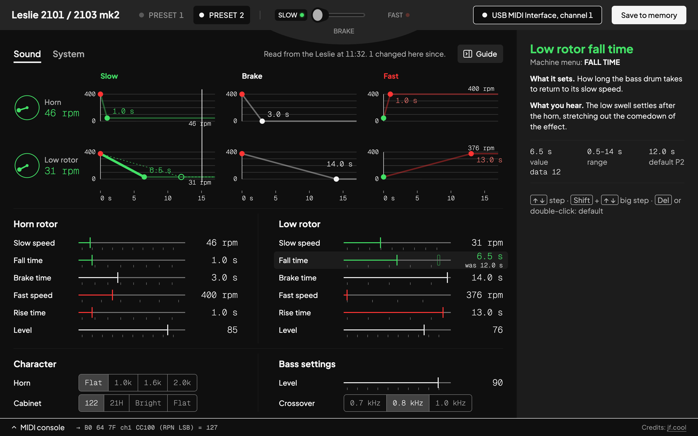

# Leslie 2101 / 2103 mk2 Editor

**Version 0.9.0, beta.** It does what it is meant to do, but has been tested on one speaker only. Keep a copy of
your settings before you use it.

A web editor for the Leslie 2101 mk2 and 2103 mk2 rotary speakers. It replaces the front panel
(one dial, a two-character display) with a single screen: every setting in real units, a graph of what
Slow, Fast and Brake will do, and a plain explanation of what each setting does and what you hear.
Changes go to the speaker live, over MIDI.



> **Unofficial project.** A personal, non-profit project. It is not affiliated with, endorsed by or
> supported by the makers of Leslie speakers or Hammond organs. Leslie, Hammond and all other names and
> trademarks belong to their respective owners; they are used here only to say which machines this editor
> works with.
>
> **Use at your own risk.** The editor sends MIDI data to your speaker and can overwrite the settings
> stored in it. See [Disclaimer](#disclaimer).

## What it does

- **Every setting on faders and keys**, in rpm, seconds and kHz, for both presets and the system settings.
- **A graph of both rotors** on the same clock, calculated from the settings: ramps, held speeds, and what
  the Leslie had before your change. Slow, Brake and Fast play it.
- **A half-moon switch** that sends Slow, Brake and Fast, and follows the mode the Leslie reports.
- **A guide**: hover or focus a setting to read what it sets, what you hear, its range and its default.
- **Reads the Leslie** from a DUMP OUT, shows what differs since, and writes the settings back to its memory.
- **Saves the dump** as a `.syx` file, to keep a copy.
- **A MIDI console** that shows every message, and a simulator when nothing is connected.

## What you need

- Chrome or Edge on a desktop computer (Web MIDI), in a window at least 1100 px wide. Not Safari, not mobile.
- A USB-MIDI interface with one input and one output.
- Two MIDI cables: interface OUT to Leslie IN, and Leslie OUT to interface IN. The second one is required:
  the editor cannot ask the Leslie for its settings, and stays locked until it receives them.

## Open it

**https://jeanfrancoisperrault.github.io/leslie-mk2-editor/**

Allow MIDI **and** SysEx when the browser asks. Nothing is installed, and the page sends nothing to any
server: it talks to the Leslie directly.

## Run it on your computer

Node.js 20.19 or later (or 22.12 or later).

```bash
git clone https://github.com/jeanfrancoisperrault/leslie-mk2-editor.git
cd leslie-mk2-editor
npm install
npm run dev
```

Then open http://localhost:5173 in Chrome or Edge.

## First use

1. Check the MIDI output, the MIDI input and the channel in the MIDI connection (top bar). The Leslie
   listens on channel 1 out of the box (CONTROL CH).
2. On the Leslie, turn FUNCTION to DUMP OUT, then press VALUE until `dP` blinks.
3. When the blinking stops, the editor shows the real settings of the machine.
4. **Keep a copy first**: Save dump (.syx), in the MIDI connection.

From there, every change is sent at once and you hear it. It changes the sound, not the memory.

### Writing to memory

**Save to memory** writes both presets and the system settings into the Leslie, permanently, as one dump.
It asks for confirmation, and starts from the last dump received, so bytes the editor does not know are
kept. The Leslie does not confirm a write: take a DUMP OUT to check.

The editor does not load a `.syx` file. To restore a copy, send it back to the Leslie with a SysEx tool:
that overwrites its memory too.

### Keyboard

| Key | On a fader |
|---|---|
| Arrows | one step |
| Shift + arrows | a big step |
| Delete or Backspace | factory default (double-click does the same) |

## What is verified, and what is not

- Tested on one mk2 unit (dump identification `HZ-100 V1.000`). A dump does not tell a 2101 from a 2103;
  the official manual is common to both.
- Addresses, ranges, conversion tables and defaults come from the official manual and its errata
  ([docs/manual-verification.md](docs/manual-verification.md), in French). The layout of the dump was found
  by tests on the machine ([docs/dump-map.md](docs/dump-map.md), in French).
- Rotor speeds on screen are calculated. Ramps are drawn straight: the machine's exact curve is not
  documented. The manual gives the brake time from fast to stop only; the editor uses it from any speed.
- A dump does not hold the rotor mode: it stays unknown until a command is sent or reported.

Have a 2103 mk2, or another firmware? A `.syx` of your DUMP OUT in an issue would help.

## Development

Vite and TypeScript, no framework, no backend. Tests with Vitest.

```bash
npm run dev        # http://localhost:5173
npm test           # unit tests
npm run typecheck
npm run build      # static files in dist/
```

| Folder | Contents |
|---|---|
| `src/params/` | the parameter schema, single source of truth |
| `src/midi/`, `src/sysex/` | NRPN, send queue, echo filter, dump reading and building |
| `src/state/` | the store |
| `src/ui/`, `src/content/` | interface and its texts |
| `fixtures/` | real dumps, used by the tests |
| `docs/` | hardware findings, decisions (`docs/adr/`) |

[DESIGN.md](DESIGN.md) describes the visual system. The pre-commit hook runs the type check and the tests;
GitHub Actions runs them again with the build, then deploys `main` to GitHub Pages.

**Before changing anything that sends MIDI**: never send a SysEx message whose meaning is not confirmed, and
nothing before a dump is loaded (the rotor keys excepted). The rules are in
[.claude/skills/leslie-midi-safety](.claude/skills/leslie-midi-safety/SKILL.md).

## Disclaimer

This editor is provided as is, without warranty of any kind. It sends MIDI data to your speaker, and Save to
memory overwrites the settings stored in it: keep a copy first. To the extent permitted by law, the author
is not liable for any malfunction, damage or loss of settings that may follow from its use.

## License

[MIT](LICENSE), Copyright (c) 2026 Jean-francois Perrault. It covers this project's code and documents, not
the names and trademarks above. Third parties: Plus Jakarta Sans and Geist Mono (SIL Open Font License,
[full text](public/third-party-licenses.txt)); some agent skills in `.claude/skills/` (MIT, see their license file there).

Credits: [jf.cool](https://jf.cool)
